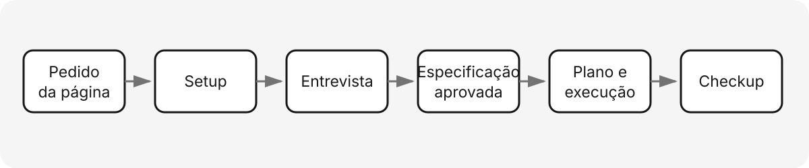
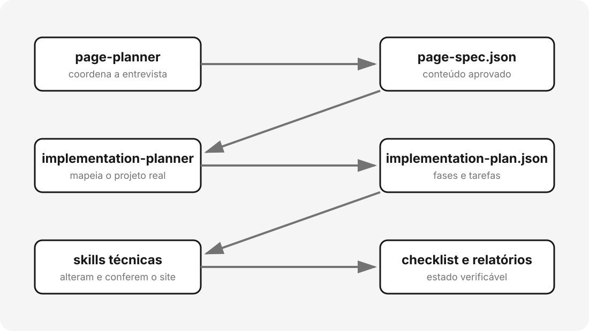

# Visão geral

Você descreve o trabalho ao agente na conversa, em linguagem natural. O
Astrofy não espera um comando nem um formato: ele examina o projeto,
decide quais das suas skills resolvem o pedido e pergunta só o que falta
para continuar. Para uma página inteira, isso significa aprovar o
conteúdo antes da edição de qualquer arquivo técnico. para um ajuste
pontual, significa registrar uma tarefa e executá-la sem reabrir uma
entrevista completa.

## Por que o percurso de página é dividido em três etapas

Uma página nova mistura duas decisões de natureza muito diferente: o que
ela diz (conteúdo, tom, oferta, prova) e como ela é construída (rota,
componentes, SEO, acessibilidade, testes). Misturar as duas no mesmo
passo tende a produzir um dos dois problemas: ou a conversa editorial
trava em detalhe técnico antes de a mensagem estar certa, ou a
implementação começa sobre conteúdo que ainda vai mudar. O Astrofy separa
essas decisões em três etapas, cada uma com uma orquestradora e um
artefato próprio:

1. **`astrofy-page-planner`** identifica o tipo de página (venda, produto,
   serviço, Home, Sobre, contato ou preços), escolhe a entrevistadora
   especializada nesse tipo e conduz a conversa até você aprovar o
   conteúdo. O resultado é `page-spec.json` — um contrato de conteúdo, sem
   nenhuma decisão de implementação ainda.
2. **`astrofy-implementation-planner`** só entra depois dessa aprovação.
   Ele relê o `page-spec.json`, cruza com a arquitetura real do projeto
   (rotas existentes, componentes disponíveis, configuração atual) e
   produz o trabalho técnico como tarefas rastreáveis — hoje, sitespecs
   ligadas à página (capítulo 4).
3. As skills técnicas selecionadas por esse plano implementam e conferem
   cada tarefa aprovada, uma a uma, registrando o que mudou.

Essa ordem não é burocracia: ela existe para que uma mudança de conteúdo
(um título diferente, uma oferta reformulada) não exija refazer trabalho
técnico que já estava correto, e para que uma decisão técnica (trocar um
componente, ajustar uma integração) não force reabrir a conversa sobre o
que a página diz.

`astrofy-setup` fica fora desse percurso de página: ele serve para a
adoção ampla do framework num projeto existente, ou para revisar a
cobertura das 54 skills contra o site atual. Se você pedir uma página
específica, o agente avalia se precisa executar o setup
antes — você não precisa pedir isso separadamente.

## Um percurso completo, do pedido ao arquivo

Veja como isso se encadeia na prática, com um pedido real:

> "Quero uma página para o nosso produto Atlas, focada em time de
> atendimento."

1. O agente identifica que isso é uma página de **produto** e aciona
   `astrofy-plan-product-page` através de `astrofy-page-planner`.
2. A entrevistadora pergunta o essencial: ação principal (demonstração?
   teste? compra?), público, capacidades a destacar, integrações reais.
   Você responde por etapas; o agente propõe três arquiteturas quando
   precisa da sua escolha e recomenda uma.
3. Quando o conteúdo está completo, o agente grava
   `.astrofy/pages/atlas/page-spec.json` (o contrato estruturado) e
   `.astrofy/pages/atlas/page.md` (a mesma informação em texto corrido,
   para você revisar sem abrir JSON). Nada de código ainda existe.
4. Você aprova. Só então `astrofy-implementation-planner` entra: ele lê o
   tipo de página, decide a skill de composição adequada (por exemplo
   `astrofy-page-design` para produto) e grava três tarefas em
   `.sitespec/`: criar a rota, aplicar o conteúdo e validar a página
   publicada. Cada uma aponta de volta para `atlas` pelos campos `page` e
   `task` do front matter (capítulo 4 detalha isso).
5. As skills técnicas executam essas tarefas em ordem (a segunda depende
   da primeira, a terceira da segunda) e registram o progresso. Você pode
   acompanhar com `astrofy sitespec progress` ou pela aba Specs da TUI em
   qualquer momento, mesmo em outra sessão.

Essas cinco etapas não publicam o site automaticamente: aprovação de
conteúdo autoriza conteúdo, aprovação de plano autoriza o trabalho técnico
descrito, e publicar o site é uma decisão sua, feita fora do Astrofy.

## Artefatos do projeto

A tabela abaixo lista onde cada decisão fica registrada e por quê. Esses
arquivos existem para que o trabalho seja retomável — uma conversa
interrompida não perde o que já foi decidido, porque a decisão está no
disco, não só no histórico da conversa.

| Caminho | Conteúdo | Por que existe |
| --- | --- | --- |
| `.astrofy/config/project.json` | Configuração criada durante a adoção do Astrofy | Registra convenções do projeto (caminhos, recursos habilitados) uma única vez, para que todo comando futuro as reconheça sem perguntar de novo |
| `.astrofy/pages/<slug>/page-spec.json` | Especificação estruturada da página aprovada | É o contrato de conteúdo; o plano técnico lê exatamente este arquivo, nunca a conversa em si |
| `.astrofy/pages/<slug>/page.md` | O mesmo conteúdo, em texto corrido | Existe só para leitura humana — revisar um JSON extenso é mais lento que ler prosa |
| `astrofy.checklist.json` | Estado das verificações executadas no site | Conserva histórico de aprovação/falha por regra e por rota, para que `astrofy check` não precise reavaliar o que não mudou |
| `.sitespec/<id>-<slug>/SITEPEC.md` | Tarefa pontual de desenvolvimento | Cobre trabalhos definidos fora de uma entrevista de página — correção, ajuste, pendência de SEO |
| `.sitespec/<id>-<slug>-<task>/SITEPEC.md` | Tarefa técnica da página (`route`, `content`, `check`) | É o que `astrofy plan` produz a partir do `page-spec.json`; `page` e `task` no front matter ligam a tarefa de volta à página |

Dois arquivos que existiam em versões anteriores do Astrofy desapareceram
de propósito: `.astrofy/plans/<slug>/implementation-plan.json` e `.md`.
O plano técnico de uma página hoje é um conjunto de sitespecs, não um
arquivo próprio — isso unifica o progresso de uma página com o progresso
de qualquer outra tarefa do site, numa única consulta (capítulos 4, 7 e 8).

## Classificação

| Campo | Valor |
| --- | --- |
| Natureza | Normativo |
| Escopo | Fluxo e artefatos públicos do Astrofy |
| Autoridade | Orquestradoras, schemas e CLI |
